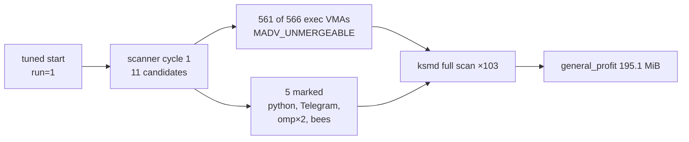

# tune

One Rust daemon, one workspace, one job: **act on Linux kernel memory reclaim
and record the evidence.**

`tuned` drives two independent subsystems — KSM merging and the zswap
`max_pool_percent` ceiling — from a single process, a single systemd unit and a
single config file. The two stay independent *inside* the workspace: they share
nothing but the process boundary, and the zswap half remains auditable on its
own.

| Crate | Role | Constraints |
|---|---|---|
| [`crates/tuned-zswap`](crates/tuned-zswap/README.md) | zswap tuner **as a library** (`tuned_zswap`) plus a standalone `tuned-zswap` binary | **std-only, zero third-party crates**; decision semantics frozen |
| [`crates/tuned`](crates/tuned/README.md) | the `tuned` binary (package `tuned-daemon`): KSM governor + ptrace scanner + a driver loop for the zswap library | `unsafe` confined to `madvise.rs`/`psi.rs`; tokio v1 |

`crates/tuned` depends on `crates/tuned-zswap` by path; the dependency is
one-directional. The zero-dependency rule attaches to the `tuned_zswap` crate
and is provable — `cargo tree -p tuned-zswap --edges normal` prints only the
crate itself. `crates/tuned-common` holds the config, procfs, PSI and KSM
support the daemon shares, including the `[zswap]` section.

## Build

```console
$ cargo build --workspace                   # tuned + the standalone tuned-zswap helper
$ cargo build -p tuned-daemon --release     # just the daemon
$ cargo build -p tuned-zswap --release      # just the standalone zswap helper
```

## Test

```console
$ cargo test --workspace
$ make check               # check + fmt + clippy
$ make test
```

## Layout

```
tune/
├── crates/
│   ├── tuned-zswap/   # std-only lib.rs (frozen decide()) + thin bin
│   ├── tuned-common/  # shared config, procfs, PSI, KSM
│   └── tuned/         # the `tuned` binary
├── config/
│   └── tuned.toml   # includes the [zswap] section
├── systemd/
│   ├── tuned.service
│   └── tuned-logrotate.conf
└── Makefile
```

The daemon writes to exactly two sysfs paths (`/sys/kernel/mm/ksm` and
`/sys/module/zswap/parameters/max_pool_percent`) and degrades rather than
panicking when a `/proc` or debugfs read fails. Full constraints, including the
behaviours an agent must not "fix", are in [AGENTS.md](AGENTS.md).

## Operating it

Read-only commands, safe to run any time — they write nothing:

```console
$ tuned status       # every subsystem at a glance
$ tuned stats        # detailed KSM counters (uksmdstats-style)
$ tuned zswap-stats  # zswap ceiling, pool free space, ratio, writeback
```

The zswap verdict needs a recorded history, so it needs root to read:

```console
$ sudo tuned zswap-verdict /var/log/tuned-zswap/stats.jsonl
```

`tuned run` needs `CAP_SYS_PTRACE` and `CAP_DAC_READ_SEARCH` to inject
`prctl(PR_SET_MEMORY_MERGE)` into other processes, which is why
[`systemd/tuned.service`](systemd/tuned.service) is the supported front end.
Foreground runs are for development:

```console
$ tuned run --dry-run    # log every action, touch nothing
```

The systemd unit is `ProtectSystem=strict`, so it takes care with
`/sys/kernel/mm/ksm` and `/sys/module/zswap/parameters`; `AmbientCapabilities`
delivers just the two capabilities it needs and `CapabilityBoundingSet` never
widens write surface beyond them. It snapshots KSM state to
`/var/lib/tuned/ksm-snapshot.json` on start and restores it on stop, so leaving
and returning KSM to its previous values never depends on how you stop the
daemon.

Stopping is clean and cheap. Restores `run=0` and the original parameters,
cancels the ptrace and poll loops, and exits 0. The pre-rename unit
`zswap-tune.service` was removed once the workspace merged; if you are upgrading
from it, `systemctl disable --now zswap-tune` and `systemctl daemon-reload`
before enabling `tuned.service` for the first time.

## Provenance

`main` is the joined history of the two predecessor repos (58 KSM commits,
7 zswap commits), merged with `--allow-unrelated-histories` and 7 post-merge
commits. `git log --follow` on a moved file surfaces its pre-merge history.

## Licence

MIT for the whole workspace — see `LICENSE`.

## Evidence

**Do not treat these numbers as a benchmark.** They are a single snapshot from
one machine, taken by the author while documenting the daemon, with no load
test, no repeated intervals and no counterfactual. Read them only as the shape
of output to expect.

### 2026-10-17, ~4 minutes after `tuned run`

| Metric | Value | Source |
|---|---|---|
| `full_scans` | 103 | `/sys/kernel/mm/ksm` |
| `general_profit` (net of rmap) | **195.1 MiB** | `tuned stats` |
| `pages_sharing` | 242.0 MiB | `tuned stats` |
| `pages_shared` (unique) | 19.5 MiB | `tuned stats` |
| sharing / shared ratio | 12.5× | `tuned stats` |
| max_pool_percent | 50% | `/sys/module/zswap/parameters` |
| PSI some avg10 | 0.25% | `/proc/pressure/memory` |

These figures are frozen at snapshot time. `ksmd` keeps scanning and the profit
keeps climbing in real time, so a fresh `tuned stats` will not match this table
— that difference is the daemon working, not an error.

Two things make this snapshot worth quoting. First, `general_profit` of 195 MiB
is the kernel's own accounting of pages freed, net of rmap overhead — roughly
1.4% of this machine's 14 GiB of DRAM, and *free* rather than swapped. Second,
it came from `pressure=idle`: PSI was under 0.3% the entire time, so the kernel
advisor never escalated, and the win came from marking processes and letting
ksmd's normal scan do the merging rather than from any aggressive tuning.

The ceiling is 50% because `decide()` measured ratio 3.42 and available ~46% and
stepped it 20→30→40→50 over successive polls. It never lowered, because lowering
is what would cost flash writes and the pool was healthy the whole time.

The profit concentrated in the same processes the scanner marked first:



The five `unprotected=1` warnings in the log are the executable-VMA guard doing
what it is designed to do: it found single VMAs per process it could not cover
and reported them rather than silently claiming complete protection. Browsers
are blocklisted by default and never get marked, so the executable-page hazard
the guard protects against is not being re-opened by the daemon's own marking.

To produce a real 50-vs-25 verdict, read
[`crates/tuned-zswap/TESTING.md`](crates/tuned-zswap/TESTING.md) — an idle pool
drains, and a drained pool yields `insufficient data` rather than a number, by
design.
